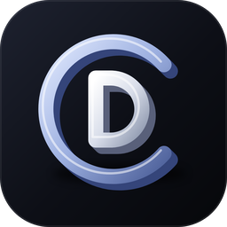

  

<h1 align="center">DaCodex</h1>

  El campus virtual de la Universidad Da Vinci, convertido en una aplicación de escritorio para Windows. 
  Tareas, mensajes, horario, clases, archivos, correo y un asistente, todo en un solo lugar.

> Proyecto independiente de un estudiante. **No es oficial.** Lee el [AVISO](AVISO.md).

## La idea

El campus web funciona, pero obliga a revisar muchas pestañas para saber qué se debe entregar, quién escribió o cuándo empieza la clase. DaCodex junta todo eso en una app sencilla y oscura, con fichas grandes y un nivel a la vez, que te avisa sola cuando algo cambia. Nació de la necesidad de un estudiante de Ingeniería en Sistemas, es **gratis**, sin fines de lucro y se reparte entre compañeros.

## Descargar

Ve a **[Releases](../../releases/latest)** y baja el instalador `DaCodex_x.y.z_x64-setup.exe`. No necesita permisos de administrador.

Al instalarlo, inicia sesión con tu usuario del campus. A partir de ahí **se actualiza sola** (espera a que termines la clase si tienes una abierta) y tu sesión no se cierra. Al abrirla por primera vez te muestra un recorrido guiado por la app real.

## Qué puedes hacer

### Tu campus, ordenado
- **Inicio:** lo urgente primero: tareas por entregar, atrasadas, mensajes y la próxima clase.
- **Cursos:** todo lo que publica el docente (descripciones, documentos, exámenes, enlaces, foros) visible y ordenado, sin que se pierda nada. Ficha del docente con su foto.
- **Tareas y exámenes:** qué entregar, qué está atrasado y cuánto sacaste. Entrega desde la app, con validación de archivos antes de subir, reemplazo de una entrega ya hecha y comentario junto con la entrega.
- **Horario y clase:** horario con cuenta regresiva y entrada directa a la clase de Teams dentro de la app (cámara y micrófono), con acceso a la asistencia.

### Comunicación
- **Mensajes:** chats con foto, avisos del campus y foros.
- **Contactos:** busca a un compañero por nombre, escríbele y envíale solicitud de contacto; ve quién está en línea.
- **Perfiles:** toca la foto o el nombre de una persona (compañero o docente) para ver su perfil sin salir de la app.
- **Correo institucional** integrado, con avisos de mensajes nuevos.

### Avisos en tiempo real
Notificaciones de tareas, mensajes, anuncios, contenido nuevo, comentarios de calificación, clases próximas y correos, con sonidos propios. La app se mantiene en la bandeja para no perderte ningún aviso.

### Archivos y documentos
- **Gestor de archivos** propio, por curso, con carpetas de tareas y descargas.
- **Visor integrado:** PDF, imágenes, texto, HTML, Word, PowerPoint, Excel y video.
- **Herramientas de PDF:** unir, dividir, extraer y ordenar páginas, girar, comprimir, PDF a imágenes o texto, imágenes a PDF, numerar, marca de agua, recortar y metadatos; también operables por el asistente.

### Navegador integrado
Nada se abre en el navegador externo: enlaces, exámenes y portales abren en pestañas dentro de la app, con favoritos, historial, descargas, zoom, buscar en la página, pestañas ancladas y sesión recordada. Incluye un **bloqueador de anuncios** (motor de Brave) con ajuste por sitio. También trae el portal **U Virtual** (pagos y datos personales).

### Asistente de IA (opcional)
Un compañero que conoce tus tareas, mensajes, horario y archivos: te lleva a donde necesitas y hace cosas por ti (abrir la clase, preparar una entrega, operar PDF y la tabla periódica) siempre con tu aprobación. Funciona con la clave de API de tu propio proveedor (Groq, Gemini y otros); tú la configuras.

### Estudio
- **Tabla periódica** con los 118 elementos, átomo en 3D, compuestos y fusión.

### Extras
- **Anti-captura:** la ventana puede ocultarse de capturas de pantalla y de lo que compartes en llamadas; la activas o desactivas con un ojo en la barra lateral.
- **Soporte:** envía fallas o ideas desde la app, con vista previa de lo que se manda.
- **Iniciar con Windows** y mantenerla siempre activa (opcional).

## Privacidad

Sin telemetría: la app no envía nada por su cuenta. Todo ocurre en tu computador y tu sesión se guarda cifrada con las herramientas de Windows. No se guardan contraseñas. Lo único que sale de tu PC es un reporte de la pestaña **Soporte**, y solo si tú lo escribes y lo envías: antes de mandarlo ves exactamente qué lleva, y se ocultan correos, claves, rutas y tu nombre.

## Contacto

Dudas, ideas o avisos para el autor: pestaña **Issues**. Seguridad: ver [SECURITY](SECURITY.md).
